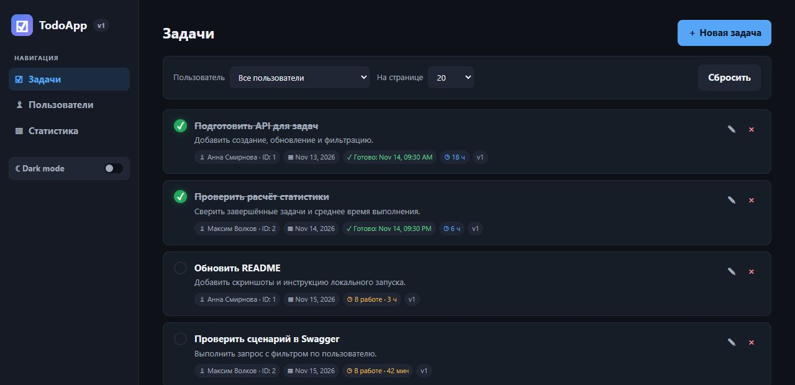

# TodoApp

TodoApp — учебный проект на Go для управления задачами. Приложение хранит данные в PostgreSQL и предоставляет REST API, веб-интерфейс и документацию Swagger.
https://kriffi-todoapp-be3n.onrender.com/

## Возможности

- Создавать, редактировать и удалять задачи и пользователей.
- Отмечать задачи выполненными и возвращать их в работу.
- Задавать необязательный срок и фильтровать просроченные задачи.
- Фильтровать задачи по пользователю, просматривать статистику по пользователю и периоду.
- Вызывать API из Swagger UI.
- Смотреть [живой дашборд в Redash](https://kriffi-todoapp-redash.onrender.com/demo) на демонстрационных данных. В приложении он открывается в разделе «Статистика». [SQL-запросы и локальный запуск](analytics/README.md).

## Сроки задач в API

- При создании и редактировании можно передать `due_date` в формате `YYYY-MM-DD`.
- В `PATCH` пропущенное поле сохраняет срок, а `null` очищает его. У старых задач срок изначально отсутствует.
- `GET /api/v1/tasks?overdue=true` отбирает только незавершённые задачи со сроком раньше текущей даты UTC. Фильтр применяется до пагинации.

## Скриншоты

На скриншотах использованы демонстрационные данные.

| Задачи | Статистика |
| --- | --- |
|  |  |

<details>
<summary>Swagger UI</summary>


</details>

## Локальный запуск

Понадобится Docker с Compose. Для команд через Makefile нужен GNU Make, для проверки кода на хосте — Go 1.27.1.

1. Скопируй `.env.example` в `.env` и задай `POSTGRES_USER`, `POSTGRES_PASSWORD` и `POSTGRES_DB`. При первом запуске используй новые локальные учётные данные. При повторном запуске сохрани параметры, с которыми инициализировалась база.
2. Запусти PostgreSQL, дождись запуска и примени миграции.

   ```bash
   make env-up
   make migrate-up
   ```

3. Собери и запусти приложение.

   ```bash
   make todoapp-deploy
   ```

   Открой [TodoApp](http://127.0.0.1:5050/) или [Swagger UI](http://127.0.0.1:5050/swagger/index.html). API доступен по адресу `http://127.0.0.1:5050/api/v1`. В пустой базе сначала создай пользователя, затем назначь ему задачу.

<details>
<summary>Запуск в Windows PowerShell без Make</summary>

Выполни из корня репозитория, заполнив `.env` как в шаге 1.

```powershell
$env:PROJECT_ROOT = (Get-Location).Path.Replace('\', '/')
docker compose up -d todoapp-postgres
docker compose exec todoapp-postgres pg_isready -h 127.0.0.1
```

После ответа `accepting connections` выполни миграции внутри контейнера. Команда использует уже переданные контейнеру переменные `POSTGRES_USER` и `POSTGRES_DB`.

```powershell
Get-ChildItem migrations/*.up.sql | Sort-Object Name | ForEach-Object {
  Get-Content -Raw -LiteralPath $_.FullName |
    docker compose exec -T todoapp-postgres sh -c 'psql -v ON_ERROR_STOP=1 -U "$POSTGRES_USER" -d "$POSTGRES_DB"'
  if ($LASTEXITCODE -ne 0) { throw "Миграция $($_.Name) не прошла" }
}
docker compose up -d --build todoapp
```

Этот блок предназначен для новой базы. Если ты уже применил первую миграцию вручную, передай в ту же команду `psql` только `migrations/000002_task_due_date.up.sql`. Для базы с учётом версий миграций используй `make migrate-up`.

</details>

## Публикация на Render Free

1. Создай отдельный проект на [Neon Free](https://neon.com/pricing).
2. В панели Render выбери **New → Blueprint** и подключи этот репозиторий с веткой `main`. [render.yaml](render.yaml) создаёт веб-сервис на тарифе Free.
3. Введи строку прямого подключения к PostgreSQL из Neon в поле `DATABASE_URL` в Render. Оставь параметры TLS из Neon.
4. После деплоя открой выданный Render HTTPS-адрес. Swagger UI доступен по пути `/swagger/index.html`.

Миграции применяются при старте контейнера. Бесплатный веб-сервис засыпает после простоя и просыпается по запросу. На публичном демо посетители могут менять общие записи. Используй отдельную демонстрационную базу без личных данных.

## Структура

- `cmd/todoapp` — запуск приложения и подключение компонентов.
- `internal/features` — пользователи, задачи, статистика и веб-страница. HTTP-обработчики, сервисы и репозитории разделены.
- `migrations` — схема PostgreSQL.
- `public/index.html` — веб-интерфейс.
- `docs` — сгенерированная спецификация Swagger и скриншоты.

```bash
go test ./...
```
