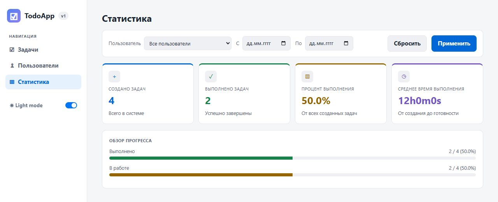
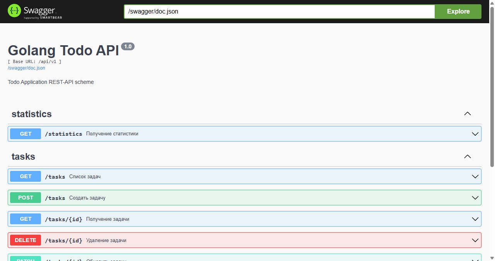

# TodoApp

TodoApp — учебный проект на Go для управления задачами. Приложение хранит данные в PostgreSQL и предоставляет REST API, веб-интерфейс и документацию Swagger.

## Возможности

- Создавать, редактировать и удалять задачи и пользователей.
- Отмечать задачи выполненными и возвращать их в работу.
- Фильтровать задачи по пользователю, просматривать статистику по пользователю и периоду.
- Вызывать API из Swagger UI.

## Скриншоты

На скриншотах использованы демонстрационные данные.

| Задачи | Статистика |
| --- | --- |
|  |  |

<details>
<summary>Swagger UI</summary>



</details>

## Локальный запуск

Понадобится Docker с Compose. Для команд через Makefile нужен GNU Make, для проверки кода на хосте — Go 1.27.1.

1. Скопируй `.env.example` в `.env` и задай `POSTGRES_USER`, `POSTGRES_PASSWORD` и `POSTGRES_DB`. При первом запуске используй новые локальные учётные данные. При повторном запуске сохрани параметры, с которыми инициализировалась база.
2. Запусти PostgreSQL, дождись запуска и примени миграции.

   ```bash
   make env-up
   make migrate-up
   ```

3. Собери и запусти приложение.

   ```bash
   make todoapp-deploy
   ```

   Открой [TodoApp](http://127.0.0.1:5050/) или [Swagger UI](http://127.0.0.1:5050/swagger/index.html). API доступен по адресу `http://127.0.0.1:5050/api/v1`. В пустой базе сначала создай пользователя, затем назначь ему задачу.

<details>
<summary>Запуск в Windows PowerShell без Make</summary>

Выполни из корня репозитория, заполнив `.env` как в шаге 1.

```powershell
$env:PROJECT_ROOT = (Get-Location).Path.Replace('\', '/')
docker compose up -d todoapp-postgres
docker compose exec todoapp-postgres pg_isready -h 127.0.0.1
```

После ответа `accepting connections` выполни миграции внутри контейнера. Команда использует уже переданные контейнеру переменные `POSTGRES_USER` и `POSTGRES_DB`.

```powershell
Get-Content -Raw migrations/000001_init.up.sql |
  docker compose exec -T todoapp-postgres sh -c 'psql -v ON_ERROR_STOP=1 -U "$POSTGRES_USER" -d "$POSTGRES_DB"'
docker compose up -d --build todoapp
```

Запускай этот SQL только на новой базе. Если хочешь использовать учёт версий миграций, используй `make migrate-up`.

</details>

## Публикация через Render

[render.yaml](render.yaml) описывает Go-сервис и отдельную базу PostgreSQL. В панели Render выбери **New → Blueprint** и подключи репозиторий с веткой main. Перед созданием проверь стоимость ресурсов. Миграции запускаются перед деплоем, после успешной проверки /healthz Render выдаёт HTTPS-адрес.

На публичном демо посетители используют общую базу и могут менять демонстрационные записи. Используй для него отдельную базу без личных данных. Локальный запуск через Docker Compose описан выше.

## Структура

- `cmd/todoapp` — запуск приложения и подключение компонентов.
- `internal/features` — пользователи, задачи, статистика и веб-страница. HTTP-обработчики, сервисы и репозитории разделены.
- `migrations` — схема PostgreSQL.
- `public/index.html` — веб-интерфейс.
- `docs` — сгенерированная спецификация Swagger и скриншоты.

```bash
go test ./...
```
